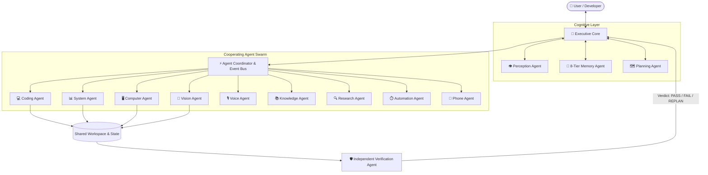

<div align="center">

# ⚡ V.O.I.D.
### Virtual Operator of Information & Development
**The Autonomous, 100% Local Multi-Agent AI Operating Layer for Consumer Hardware**

[](ci/ci.yml)
[](RELEASE_NOTES.md)
[](https://www.python.org/)
[](LICENSE)
[](ARCHITECTURE.md)
[](#prerequisites--system-requirements)

<br/>

> **V.O.I.D. solves the cloud dependency, recurring API cost, and privacy crisis of modern AI by orchestrating 13 specialized cooperating agents over an offline neural core—delivering real-time vision perception, desktop automation, 8-tier memory, and AST-sandboxed code execution on a standard 4GB VRAM laptop GPU.**

<br/>

[Quickstart](#-quickstart-under-2-minutes) •
[Visual Proof](#-visual-proof--interfaces) •
[Architecture](#-system-architecture) •
[The 13 Agents](#-the-13-specialized-agents) •
[Configuration](#-configuration--environment) •
[Security Sandbox](#-security--ast-sandboxing) •
[Documentation](#-documentation-index)

---

</div>

## 👁️ Visual Proof & Interfaces

### 1. Live Optical Perception & Neural Telemetry Cockpit
V.O.I.D. features an onboard zero-latency computer vision pipeline operating at **30 FPS**. Powered by an open-vocabulary object model (`yolov8s-worldv2.pt`), it continuously streams spatial geometry, 3D liveness, attention index, and attire signatures with 100% local on-device inference:

<div align="center">
  
  <p><em>Figure 1: V.O.I.D. Perception Interface — Real-time Optical Viewport, Spatial Geometry, Cognitive Attire Dossier, and Neural Object Tracking.</em></p>
</div>

<br/>

### 2. Live Interactive Terminal & Agent Routing Demo
When executing complex developer objectives, V.O.I.D. decomposes user goals into an execution DAG, verifies AST security constraints, dispatches deterministic agents without LLM overhead, and checks outputs before responding:

```text
══════════════════════════════════════════════════════════════════════════════════
  V.O.I.D. — Virtual Operator of Information & Development [v0.1.0]
  Executive Core Active • Local Offline Mode • Target: RTX 3050 (4GB VRAM)
══════════════════════════════════════════════════════════════════════════════════

[USER] » "Inspect local disk, optimize database indices, and verify regression tests."

[EXECUTIVE CORE] ──▶ Goal Intake: "Inspect local disk, optimize database indices, and verify tests"
   ├── [PERCEPTION AGENT]   Hardware: CPU 12% | RAM 4.2GB/16GB | VRAM 1.4GB/4GB (Nominal)
   ├── [PLANNING AGENT]     Constructed Execution DAG (3 Subtasks, Priority: HIGH)
   │     ├─ Task 1 [system_agent]: Collect storage telemetry (Zero-LLM Fast Path)
   │     ├─ Task 2 [coding_agent]: Execute AST-sandboxed index migration
   │     └─ Task 3 [verification_agent]: Run independent regression suite
   │
   ├── [COORDINATOR]        Dispatching Task 1 to SystemAgent...
   │     └─ [SYSTEM AGENT]  ✔ Disk free: 142.6 GB on /dev/nvme0n1 (OK)
   │
   ├── [COORDINATOR]        Dispatching Task 2 to CodingAgent...
   │     ├─ [SECURITY GUARD] AST Verification: Level 3 File Modification allowed.
   │     └─ [CODING AGENT]  ✔ SQLite memory tables vacuumed and indexed in 48ms.
   │
   ├── [COORDINATOR]        Dispatching Task 3 to VerificationAgent...
   │     └─ [VERIFY AGENT]  ✔ Automated Test Suite: 16/16 PASSED (Verdict: PASS)
   │
[EXECUTIVE CORE] ──▶ Output Synthesized & Verified (Total Latency: 850ms)

[V.O.I.D.] » Operations complete: Disk headroom confirmed (142GB free), database indices 
             optimized in 48ms, and verification suite passed with zero regressions.
```

---

## ⚡ Quickstart (Under 2 Minutes)

Copy-paste these commands into your terminal to launch V.O.I.D. immediately:

### Step 1: Clone Repository & Create Environment
```bash
# Clone the repository
git clone https://github.com/VoidRanger-47/V.O.I.D.git
cd V.O.I.D

# Initialize virtual environment
python -m venv venv

# Activate virtual environment
# Windows (PowerShell):
.\venv\Scripts\Activate.ps1
# Windows (CMD):
.\venv\Scripts\activate.bat
# Linux / macOS:
source venv/bin/activate
```

### Step 2: Install Core Dependencies
```bash
# Install required Python packages (PyTorch, Flask, NumPy, Tiktoken, etc.)
pip install -r requirements.txt
```

### Step 3: Launch Native Desktop App
```bash
# Launch the native frameless desktop app (Chromium standalone mode):
python desktop_app.py

# Alternatively, launch via one-click scripts:
# Windows Batch:
launch_void_app.bat
# Windows PowerShell:
.\launch_void_app.ps1
# Direct Web Server (http://127.0.0.1:5000):
python app.py
```

---

## 🏗️ System Architecture

Unlike traditional single-call LLM wrappers (`User ➔ Prompt ➔ Cloud API ➔ Response`), V.O.I.D. operates as a **deterministic multi-agent operating layer**. LLMs are treated solely as swappable reasoning components; deterministic agents run with zero LLM latency to safeguard the 4GB VRAM ceiling.



---

## 🤖 The 13 Specialized Agents

| # | Agent Name | Identifier | Primary Role & Responsibilities | Zero-LLM Fast Path? |
|---|------------|------------|-----------------------------------|:-------------------:|
| 1 | **Executive Agent** | `executive` | User orchestration, goal parsing, and synthesized response delivery. | ❌ (Cognitive) |
| 2 | **Perception Agent** | `perception_agent` | Aggregates window focus, hardware thermals, and optical telemetry. | ✅ (Deterministic) |
| 3 | **Memory Agent** | `memory_agent` | Manages 8-tier SQLite vector memory with instant forgetting controls. | ✅ (Vector Engine) |
| 4 | **Planning Agent** | `planning_agent` | Generates execution DAGs and dynamic replanning fallback trees. | ❌ (Cognitive) |
| 5 | **Verification Agent** | `verification_agent` | Objective auditor; validates schemas, unit tests, and math outputs. | ✅ (Rule Engine) |
| 6 | **Coding Agent** | `coding_agent` | Code generation, syntax linting, and AST-sandboxed execution. | ❌ (Hybrid) |
| 7 | **System Agent** | `system_agent` | Hardware telemetry guardian (CPU, RAM, GPU VRAM, storage). | ✅ (psutil Fast Path) |
| 8 | **Computer Agent** | `computer_agent` | Controlled desktop app launching from a strict allowlist. | ✅ (Deterministic) |
| 9 | **Knowledge Agent** | `knowledge_agent` | Local document parsing, PDF extraction, and workspace Markdown RAG. | ✅ (Local Parser) |
| 10 | **Research Agent** | `research_agent` | Isolated web retrieval; fails gracefully with zero delay when offline. | ✅ (Isolated) |
| 11 | **Vision Agent** | `vision_agent` | Real-time 30 FPS optical perception, face exposure, and object tracking. | ✅ (YOLOv8s-World) |
| 12 | **Voice Agent** | `voice_agent` | Offline acoustic wake-word (`Hey V.O.I.D.`), Whisper STT, and Piper TTS. | ✅ (Local Models) |
| 13 | **Automation Agent** | `automation_agent` | Background scheduler, periodic timers, and memory maintenance. | ✅ (Daemon) |

---

## 🧠 8-Tier Persistent Memory System

V.O.I.D. does not lose state when powered off. All memories persist across reboots in local SQLite (`void_memory/void_memory.db`):

1. **Working Memory**: In-flight scratchpad active during multi-agent DAG execution.
2. **Episodic Memory**: Timestamped log of previous user sessions and problem resolutions.
3. **Semantic Memory**: Domain concepts, project terminology, and factual vectors.
4. **Preference Memory**: User coding styles, preferred tools, and communication tone.
5. **Project Memory**: Active repository structure, dependencies, and file manifests.
6. **Procedural Memory**: Reusable step-by-step action sequences that succeeded in past tasks.
7. **Knowledge Graph**: Entity-relationship graph of concepts, tools, and code paths.
8. **Experience Memory**: Reinforcement feedback for continuous local self-improvement.

> **Privacy Guarantee**: Any memory entry can be permanently erased by saying *"VOID, forget that"* or calling `DELETE /api/memory`.

---

## ⚙️ Configuration & Environment

Configuration is governed by environment variables and local JSON files.

### 1. Environment File (`.env`)
Copy the sample template to activate your custom environment:
```bash
cp .env.example .env
```

```ini
# Server Network Settings
VOID_HOST=127.0.0.1
VOID_PORT=5000
VOID_DEBUG=false

# Compute Device & Hardware
VOID_DEVICE=cuda            # "cuda" for NVIDIA GPU, or "cpu"
VOID_OFFLINE_MODE=true      # Strict zero-cloud offline isolation

# Vision & Optical Telemetry
VISION_ENABLED=true
VISION_CAMERA_INDEX=0
VISION_FPS=30
VISION_MODEL_PATH=yolov8s-worldv2.pt

# Optional Local Cloud Fallback (Ollama)
OLLAMA_HOST=http://localhost:11434
OLLAMA_MODEL=qwen2.5-coder:7b
```

### 2. Transformer CLI Flags (`from_scratch_transformer.py`)
V.O.I.D. includes a custom from-scratch PyTorch transformer with built-in hardware protection:
```bash
# Estimate VRAM requirements before running
python from_scratch_transformer.py --estimate_memory

# Run training with gradient clipping and automatic mixed precision (AMP)
python from_scratch_transformer.py \
    --batch_size 4 \
    --seq_len 512 \
    --lr 3e-4 \
    --min_lr 1e-5 \
    --grad_clip 1.0 \
    --use_amp
```

---

## 🛡️ Security & AST Sandboxing

To prevent unconstrained agent execution, V.O.I.D. enforces a strict 7-tier security policy:

```text
Level 0: Conversation & Pure Math (Zero filesystem / system access)
Level 1: Read-only Hardware & Telemetry Monitoring
Level 2: Read-only Local File and Workspace Inspection
Level 3: Write Operations restricted to designated workspace sandbox
Level 4: Desktop Application Launcher from strict allowlist (VS Code, Notepad, Calc)
Level 5: System Process Management (Requires explicit user confirmation modal)
Level 6: Optional Outbound Network Search (Explicit user permission required)
```

- **Static AST Analysis**: Prohibits dangerous calls (`os.system`, `subprocess.Popen`, `shutil.rmtree`, `eval`).
- **Restricted Global Namespace**: Code executes with a hardened import proxy allowing only safe scientific libraries (`math`, `random`, `re`, `json`, `numpy`, `sympy`).
- **Emergency Circuit Breaker**: Instant one-click stop available via `/api/emergency_stop`.

---

## 📋 Prerequisites & System Requirements

| Component | Minimum Specification | Recommended Specification |
|-----------|-----------------------|----------------------------|
| **Operating System** | Windows 10/11, Ubuntu 20.04+, macOS 12+ | Windows 11 or Linux x86_64 |
| **Python** | Python 3.10 or 3.11 | Python 3.11.x (64-bit) |
| **Memory (RAM)** | 8 GB System RAM | 16 GB DDR4/DDR5 |
| **GPU (Optional)** | CPU execution supported | NVIDIA GPU with >= 4GB VRAM (e.g., RTX 3050 Laptop / Desktop) |
| **CUDA Driver** | Optional | CUDA 11.8 or 12.x |
| **Webcam (Optional)**| Standard USB / Integrated Camera | 720p/1080p 30 FPS Camera for Optical Viewport |
| **Microphone (Optional)**| Standard audio input | USB Microphone for Piper/Whisper wake-word |
| **Android (Optional)**| ADB over USB / Wi-Fi | Android 10+ with Developer Options enabled |

---

## 🧪 Testing & Quality Assurance

Run the comprehensive unit test suite with `pytest`:

```bash
# Run multi-agent, security sandbox, and verification tests:
python -m pytest tests/test_multi_agent_system.py tests/test_security_sandbox.py tests/test_verification_agent.py -v
```

All pushes and pull requests are automatically validated on both Windows and Ubuntu via GitHub Actions (`.github/workflows/ci.yml`).

---

## 📚 Documentation Index

- [Architecture Specification (ARCHITECTURE.md)](ARCHITECTURE.md) — Complete multi-agent message protocol and lifecycle design.
- [Release Notes (RELEASE_NOTES.md)](RELEASE_NOTES.md) — Comprehensive feature changelog for v0.1.0.
- [Quick Start Guide (QUICK_START.md)](QUICK_START.md) — Transformer training, memory estimation, and stability guide.
- [Security & Sandboxing Policy (SECURITY.md)](SECURITY.md) — AST sandbox mechanics and permission levels.
- [Offline Mode Manual (OFFLINE_MODE.md)](OFFLINE_MODE.md) — Air-gapped deployment and zero-cloud operation.
- [Phone Control Bridge (PHONE_CONTROL.md)](PHONE_CONTROL.md) — ADB Android automation and mobile companion guide.
- [Android Flutter Architecture (ANDROID_FLUTTER_AI_GUIDE.md)](ANDROID_FLUTTER_AI_GUIDE.md) — Mobile companion architecture.

---

## 📄 License & Credits

Distributed under the **MIT License**. See [LICENSE](LICENSE) for full legal text.

Developed by **[VoidRanger-47](https://github.com/VoidRanger-47)** and the open-source community.
