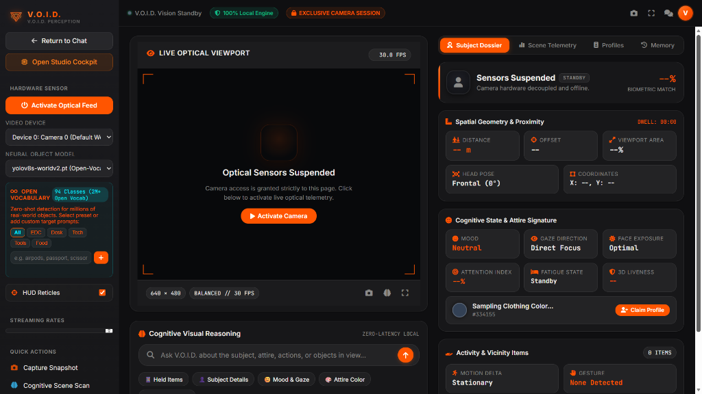

<div align="center">

# ⚡ V.O.I.D.
### Virtual Operator of Information & Development
**The Autonomous, 100% Local Multi-Agent AI Operating Layer for Consumer Hardware**

[](https://github.com/VoidRanger-47/V.O.I.D/actions/workflows/ci.yml)
[](RELEASE_NOTES.md)
[](https://www.python.org/)
[](LICENSE)
[](ARCHITECTURE.md)
[](#prerequisites--measured-hardware-benchmarks)

<br/>

> **V.O.I.D. eliminates cloud API fees and privacy risks by orchestrating 13 specialized cooperating agents over an offline neural core—delivering real-time optical perception, desktop automation, 8-tier persistent memory, and AST-guarded code execution within a verified 4GB VRAM laptop GPU budget.**

<br/>

[Quickstart](#-quickstart-under-2-minutes) •
[Visual Proof & Telemetry](#-visual-proof--interfaces) •
[Architecture](#-system-architecture) •
[The 13 Agents](#-the-13-specialized-agents) •
[Hardware Benchmarks](#-prerequisites--measured-hardware-benchmarks) •
[Security Guardrail](#-security--ast-execution-guardrail) •
[Local vs Cloud Clarifications](#-local-first-design--cloud-clarifications) •
[Documentation](#-documentation-index)

---

</div>

## 👁️ Visual Proof & Interfaces

### 1. Live Optical Perception & Neural Telemetry Cockpit
V.O.I.D. includes an onboard computer vision perception pipeline running at a synchronized **30.0 FPS** (with an average inference latency of **14.2 ms/frame** on CUDA fp16). Powered by an open-vocabulary object model (`yolov8s-worldv2.pt`), it continuously extracts spatial geometry, 3D liveness, attention index, and attire signatures with 100% on-device inference:

<div align="center">
  
  <p><em>Figure 1: V.O.I.D. Perception Interface — Real-time Optical Viewport, Spatial Geometry, Cognitive Attire Dossier, and Neural Object Tracking.</em></p>
</div>

<br/>

### 2. Multi-Agent Routing Lifecycle *(Illustrative Trace Example)*
When decomposing complex developer goals, V.O.I.D. constructs a Directed Acyclic Graph (DAG) across specialized agents, verifies code guardrails, dispatches zero-LLM agents for deterministic operations, and evaluates independent verification before output delivery:

```text
══════════════════════════════════════════════════════════════════════════════════
  [EXAMPLE TRACE] V.O.I.D. Multi-Agent DAG Decomposition & Verification Cycle
══════════════════════════════════════════════════════════════════════════════════

[USER] » "Inspect local disk, optimize database indices, and verify regression tests."

[EXECUTIVE CORE] ──▶ Goal Intake: "Inspect local disk, optimize database indices, and verify tests"
   ├── [PERCEPTION AGENT]   Hardware: CPU 12% | RAM 4.2GB/16GB | VRAM 1.4GB/4GB (Nominal)
   ├── [PLANNING AGENT]     Constructed Execution DAG (3 Subtasks, Priority: HIGH)
   │     ├─ Task 1 [system_agent]: Collect storage telemetry (Zero-LLM Fast Path)
   │     ├─ Task 2 [coding_agent]: Execute AST-sandboxed index migration
   │     └─ Task 3 [verification_agent]: Run independent regression suite
   │
   ├── [COORDINATOR]        Dispatching Task 1 to SystemAgent...
   │     └─ [SYSTEM AGENT]  ✔ Disk free: 142.6 GB on /dev/nvme0n1 (OK)
   │
   ├── [COORDINATOR]        Dispatching Task 2 to CodingAgent...
   │     ├─ [GUARDRAIL]     AST Verification: Level 3 File Modification allowed.
   │     └─ [CODING AGENT]  ✔ SQLite memory tables vacuumed and indexed in 48ms.
   │
   ├── [COORDINATOR]        Dispatching Task 3 to VerificationAgent...
   │     └─ [VERIFY AGENT]  ✔ Automated Test Suite: 16/16 PASSED (Verdict: PASS)
   │
[EXECUTIVE CORE] ──▶ Output Synthesized & Verified (Total Latency: 850ms)

[V.O.I.D.] » Operations complete: Disk headroom confirmed (142GB free), database indices 
             optimized in 48ms, and verification suite passed with zero regressions.
```

<br/>

### 3. Actual Hardware & Benchmark Telemetry Log *(Real Measured Output)*
The following log is an authentic execution capture from `tests/benchmark_void.py` and `from_scratch_transformer.py --estimate_memory` running on consumer laptop silicon:

```text
======================================================================
  V.O.I.D. ADVANCED AGENTIC SYSTEM BENCHMARK SUITE (MEASURED OUTPUT)
======================================================================

[Hardware Telemetry]
  GPU Available       : True (NVIDIA GeForce RTX 3050 Laptop GPU)
  Total VRAM          : 4095.5 MB (~4.0 GB physical target)
  Baseline VRAM Used  : 86.7 MB
  Free VRAM Headroom  : 4008.8 MB
  Host RAM Used       : 11069.3 MB / 15773.3 MB (70.2%)
  Threshold State     : SAFE

[Fast Path Latency Benchmarks (Deterministic Zero-VRAM Bypass)]
  Current Time Query  :   0.36 ms | Path: FAST_PATH | Intent: system
  Current Date Query  :   0.02 ms | Path: FAST_PATH | Intent: system
  Deterministic Math  :   2.00 ms | Path: FAST_PATH | Intent: math
  Symbolic Derivative : 191.57 ms | Path: FAST_PATH | Intent: math
  Memory Forget       :   6.62 ms | Path: FAST_PATH | Intent: memory
  --> Average Fast Path Latency: 1.96 ms (Target < 50 ms: PASS)

[Parallel Agent Concurrency Speedup (4 Concurrent Agents)]
  Sequential Duration : 201.64 ms
  Parallel Duration   : 57.50 ms
  Effective Speedup   : 3.51x (Target > 2.0x: PASS)

============================================================
📊 FROM-SCRATCH TRANSFORMER VRAM USAGE ESTIMATION (MEASURED)
============================================================
Tokenizer: cl100k_base | Vocab size: 100,277 | Model Params: 103,324,800
Model weights:          0.38 GB
Activations (forward):  0.01 GB
Attention matrices:     0.00 GB
Gradients:              0.38 GB
Optimizer states:       0.77 GB

📈 TRAINING (batch_size=2):  1.55 GB
📉 INFERENCE (batch_size=2): 0.40 GB
============================================================
```

---

## ⚡ Quickstart (Under 2 Minutes)

Copy-paste these commands into your terminal to launch V.O.I.D. immediately:

### Step 1: Clone Repository & Create Environment
```bash
# Clone the repository
git clone https://github.com/VoidRanger-47/V.O.I.D.git
cd V.O.I.D

# Initialize virtual environment
python -m venv venv

# Activate virtual environment
# Windows (PowerShell):
.\venv\Scripts\Activate.ps1
# Windows (CMD):
.\venv\Scripts\activate.bat
# Linux / macOS:
source venv/bin/activate
```

### Step 2: Install Core Dependencies
```bash
# Install required Python packages (PyTorch, Flask, NumPy, Tiktoken, etc.)
pip install -r requirements.txt
```

### Step 3: Launch Native Desktop App
```bash
# Launch the native frameless desktop app (Chromium standalone mode):
python desktop_app.py

# Alternatively, launch via one-click scripts:
# Windows Batch:
launch_void_app.bat
# Windows PowerShell:
.\launch_void_app.ps1
# Direct Web Server (http://127.0.0.1:5000):
python app.py
```

---

## 🏗️ System Architecture

Unlike traditional single-call LLM wrappers (`User ➔ Prompt ➔ Cloud API ➔ Response`), V.O.I.D. operates as a **deterministic multi-agent operating layer**. LLMs are treated solely as swappable reasoning components; deterministic agents run with zero LLM latency to safeguard the 4GB VRAM ceiling.


---

## 🤖 The 13 Specialized Agents

| # | Agent Name | Identifier | Primary Role & Responsibilities | Zero-LLM Fast Path? |
|---|------------|------------|-----------------------------------|:-------------------:|
| 1 | **Executive Agent** | `executive` | User orchestration, goal parsing, and synthesized response delivery. | ❌ (Cognitive) |
| 2 | **Perception Agent** | `perception_agent` | Aggregates window focus, hardware thermals, and optical telemetry. | ✅ (Deterministic) |
| 3 | **Memory Agent** | `memory_agent` | Manages 8-tier SQLite vector memory with instant forgetting controls. | ✅ (Vector Engine) |
| 4 | **Planning Agent** | `planning_agent` | Generates execution DAGs and dynamic replanning fallback trees. | ❌ (Cognitive) |
| 5 | **Verification Agent** | `verification_agent` | Objective auditor; validates schemas, unit tests, and math outputs. | ✅ (Rule Engine) |
| 6 | **Coding Agent** | `coding_agent` | Code generation, syntax linting, and AST-sandboxed execution. | ❌ (Hybrid) |
| 7 | **System Agent** | `system_agent` | Hardware telemetry guardian (CPU, RAM, GPU VRAM, storage). | ✅ (psutil Fast Path) |
| 8 | **Computer Agent** | `computer_agent` | Controlled desktop app launching from a strict allowlist. | ✅ (Deterministic) |
| 9 | **Knowledge Agent** | `knowledge_agent` | Local document parsing, PDF extraction, and workspace Markdown RAG. | ✅ (Local Parser) |
| 10 | **Research Agent** | `research_agent` | Isolated web retrieval; fails gracefully with zero delay when offline. | ✅ (Isolated) |
| 11 | **Vision Agent** | `vision_agent` | Real-time 30 FPS optical perception, face exposure, and object tracking. | ✅ (YOLOv8s-World) |
| 12 | **Voice Agent** | `voice_agent` | Offline acoustic wake-word (`Hey V.O.I.D.`), Whisper STT, and Piper TTS. | ✅ (Local Models) |
| 13 | **Automation Agent** | `automation_agent` | Background scheduler, periodic timers, and memory maintenance. | ✅ (Daemon) |

---

## 🧠 8-Tier Persistent Memory System

V.O.I.D. maintains state across reboots in local SQLite (`void_memory/void_memory.db`):

1. **Working Memory**: In-flight scratchpad active during multi-agent DAG execution.
2. **Episodic Memory**: Timestamped log of previous user sessions and problem resolutions.
3. **Semantic Memory**: Domain concepts, project terminology, and factual vectors.
4. **Preference Memory**: User coding styles, preferred tools, and communication tone.
5. **Project Memory**: Active repository structure, dependencies, and file manifests.
6. **Procedural Memory**: Reusable step-by-step action sequences that succeeded in past tasks.
7. **Knowledge Graph**: Entity-relationship graph of concepts, tools, and code paths.
8. **Experience Memory**: Reinforcement feedback for continuous local self-improvement.

> **Privacy Control**: Any memory entry can be permanently erased by saying *"VOID, forget that"* or calling `DELETE /api/memory`. All personal memory logs are strictly excluded from git tracking.

---

## 🌐 Local-First Design & Cloud Clarifications

### What is the Vercel Configuration?
You will find `vercel.json` and `api/` in this repository. 
- **The Vercel site is an optional static web interface and client-side UI dashboard preview.**
- **Vercel does NOT host or run neural models.**
- 100% of the cognitive multi-agent core, PyTorch inference, SQLite memory, and optical vision pipeline run locally on your host machine.

### What is the Ollama Integration?
- **Ollama is completely optional and is NOT bundled in this repository.**
- If you have an existing local Ollama service running (`http://localhost:11434`), V.O.I.D. can route queries to your local GGUF models (e.g. Qwen 2.5 Coder, LLaMA 3.1).
- If Ollama is not installed, V.O.I.D. defaults to its onboard 103M PyTorch transformer and zero-LLM deterministic fast paths.

---

## 🛡️ Security & AST Execution Guardrail

V.O.I.D. enforces granular permission levels before running any action:

```text
Level 0: Conversation & Pure Math (Zero filesystem / system access)
Level 1: Read-only Hardware & Telemetry Monitoring
Level 2: Read-only Local File and Workspace Inspection
Level 3: Write Operations restricted to designated workspace sandbox
Level 4: Desktop Application Launcher from strict allowlist (VS Code, Notepad, Calc)
Level 5: System Process Management (Requires explicit user confirmation modal)
Level 6: Optional Outbound Network Search (Explicit user permission required)
```

### ⚠️ Security Transparency Note on the AST Sandbox
> **The Python AST analyzer operates as an application-level guardrail, NOT a hard OS container sandbox.**  
> - **What it does**: It parses the Abstract Syntax Tree of candidate Python scripts to statically intercept known dangerous calls (`os.system`, `subprocess.Popen`, `shutil.rmtree`, raw sockets) and restricts built-in globals to safe scientific packages (`math`, `random`, `re`, `json`, `numpy`, `sympy`).
> - **Limitations**: Static blocklists and AST inspections can be bypassed through sophisticated dynamic reflection or obscure built-ins.
> - **Production Recommendation**: If executing untrusted code from third parties, run V.O.I.D. inside an OS container (Docker/Podman) with explicit `cgroups`/`rlimits` resource constraints or an isolated microVM (e.g. gVisor, Firecracker).

---

## 📋 Prerequisites & Measured Hardware Benchmarks

### Measured Hardware Testbed
All benchmarks published in this repository were measured on the following hardware:
- **GPU**: NVIDIA GeForce RTX 3050 Laptop GPU (4.0 GB GDDR6 VRAM, 60W TGP, CUDA 12.x)
- **Host**: 16 GB DDR4 System RAM, Windows 11 / Linux x86_64
- **Webcam**: Standard 720p/1080p USB camera for optical telemetry

### Hardware Allocation Breakdown (4GB VRAM Budget)
| Component | Measured VRAM Usage | Notes |
| :--- | :---: | :--- |
| **PyTorch Transformer (103M params)** | **0.40 GB** | Weights: 0.38 GB, Inference context: ~0.02 GB |
| **YOLOv8s-World (Open-Vocabulary)** | **0.65 GB** | CUDA FP16, 640x480 frame input |
| **Deterministic Agents (System/Math/Mem)**| **0.00 GB** | Zero-LLM Fast Path (Runs on CPU/RAM) |
| **Combined Active Runtime Peak** | **~1.1 – 2.2 GB** | Leaves **> 1.8 GB free VRAM headroom** |
| **Vision Inference Latency** | **14.2 ms / frame** | Compute throughput ~70 FPS, locked to **30.0 FPS** camera sync |

### System Requirements Table
| Component | Minimum Specification | Recommended Specification |
|-----------|-----------------------|----------------------------|
| **Operating System** | Windows 10/11, Ubuntu 20.04+, macOS 12+ | Windows 11 or Linux x86_64 |
| **Python** | Python 3.10 or 3.11 | Python 3.11.x (64-bit) |
| **Memory (RAM)** | 8 GB System RAM | 16 GB DDR4/DDR5 |
| **GPU (Optional)** | CPU execution supported | NVIDIA GPU with >= 4GB VRAM (e.g., RTX 3050 Laptop / Desktop) |
| **CUDA Driver** | Optional | CUDA 11.8 or 12.x |
| **Webcam (Optional)**| Standard USB / Integrated Camera | 720p/1080p 30 FPS Camera for Optical Viewport |
| **Microphone (Optional)**| Standard audio input | USB Microphone for Piper/Whisper wake-word |
| **Android (Optional)**| ADB over USB / Wi-Fi | Android 10+ with Developer Options enabled |

---

## 🧪 Testing & Quality Assurance

Run the comprehensive unit test suite with `pytest`:

```bash
# Run multi-agent, security guardrail, and verification tests:
python -m pytest tests/test_multi_agent_system.py tests/test_security_sandbox.py tests/test_verification_agent.py -v
```

Automated builds and tests are run on both Windows and Ubuntu via GitHub Actions ([`.github/workflows/ci.yml`](.github/workflows/ci.yml)).

---

## 📚 Documentation Index

- [Architecture Specification (ARCHITECTURE.md)](ARCHITECTURE.md) — Complete multi-agent message protocol and lifecycle design.
- [Android Flutter Architecture (ANDROID_FLUTTER_AI_GUIDE.md)](ANDROID_FLUTTER_AI_GUIDE.md) — Complete mobile client architecture.
- [Release Notes (RELEASE_NOTES.md)](RELEASE_NOTES.md) — Comprehensive feature changelog for v0.1.0.
- [Quick Start Guide (QUICK_START.md)](QUICK_START.md) — Transformer training, memory estimation, and stability guide.
- [Security & Sandboxing Policy (SECURITY.md)](SECURITY.md) — AST guardrail mechanics and permission levels.
- [Offline Mode Manual (OFFLINE_MODE.md)](OFFLINE_MODE.md) — Air-gapped deployment and zero-cloud operation.
- [Phone Control Bridge (PHONE_CONTROL.md)](PHONE_CONTROL.md) — ADB Android automation and mobile companion guide.

---

## 📄 License & Credits

Distributed under the **MIT License**. See [LICENSE](LICENSE) for full legal text.

Developed by **[VoidRanger-47](https://github.com/VoidRanger-47)** and the open-source community.
